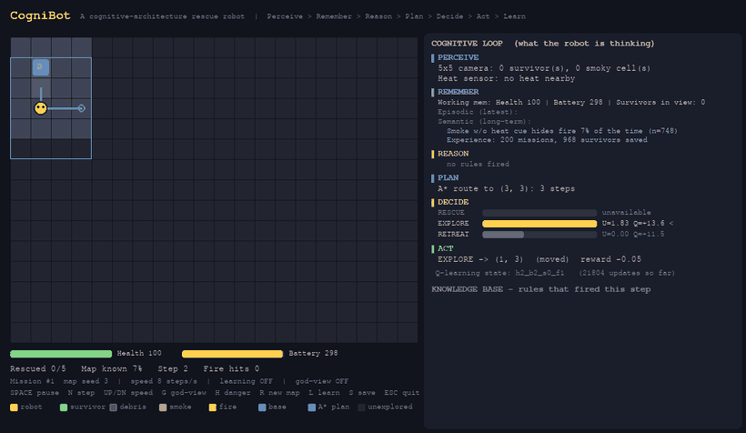
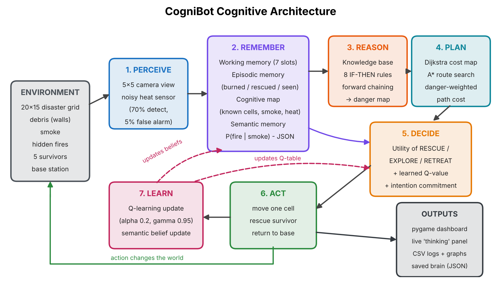
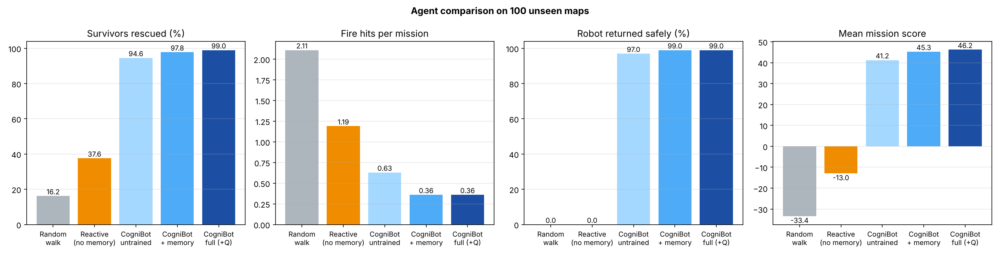

# CogniBot

[](../../actions/workflows/ci.yml)


**A cognitive-architecture rescue robot simulator.** CogniBot searches a disaster zone for trapped
survivors while fire hides inside smoke and its sensors are noisy. Instead of reacting blindly, it
runs a full cognitive loop: it perceives, remembers, reasons, plans, decides, acts and learns. A live
dashboard shows what the robot is "thinking" at every step.



## Highlights

- **Complete cognitive architecture**, inspired by SOAR and ACT-R, with one module per cognitive function.
- **Explainable by design**: the side panel displays perception, memories, fired rules, plan, option scores and action in real time.
- **Learns from experience**: Q-learning plus a Bayesian belief about hidden fire, saved between sessions.
- **Measured, reproducible results**: five agents compared on 100 unseen maps with fixed random seeds.
- **Lightweight**: pure Python, CPU only, about 1 ms per decision. Runs on an entry-level laptop.

## How it works

```
Environment -> Perceive -> Remember -> Reason -> Plan -> Decide -> Act -> Learn -> Environment
```

| Stage | What CogniBot does | Module |
|---|---|---|
| Perceive | 5x5 camera view; noisy heat sensor (70% detection, 5% false alarms); fire is invisible inside smoke | `cognibot/perception.py` |
| Remember | Cognitive map, 7-slot working memory, episodic memory, semantic memory `P(fire \| smoke)` | `cognibot/memory.py` |
| Reason | Knowledge base of 8 IF-THEN rules (forward chaining) producing a danger map and goal flags | `cognibot/reasoning.py` |
| Plan | Dijkstra cost map for goal evaluation, A* search for routes; danger raises path cost | `cognibot/planning.py` |
| Decide | Utility scores for RESCUE / EXPLORE / RETREAT, plus learned Q-values and intention commitment | `cognibot/decision.py` |
| Learn | Tabular Q-learning (alpha 0.2, gamma 0.95) and Bayesian belief updates | `cognibot/learning.py` |

`cognibot/agent.py` integrates every stage into one cognitive cycle and also defines the two baseline agents.



## Results

Trained for 200 missions, then evaluated on 100 maps it had never seen:

| Agent | Survivors rescued | Fire hits / mission | Returned safely | Mean score |
|---|---|---|---|---|
| Random walk | 16.2% | 2.11 | 0% | -33.42 |
| Reactive (no memory) | 37.6% | 1.19 | 0% | -13.00 |
| CogniBot, untrained | 94.6% | 0.63 | 97% | 41.24 |
| CogniBot + memory learning | 97.8% | 0.36 | 99% | 45.26 |
| **CogniBot, full (memory + Q-learning)** | **99.0%** | **0.36** | **99%** | **46.20** |



Full tables are in [`results/summary.md`](results/summary.md). Rerunning `python evaluate.py` reproduces these numbers.

## Getting started

### Requirements

- Python 3.10, 3.11 or 3.12
- Windows, macOS or Linux; no GPU required

### Installation

```bash
git clone <repository-url>
cd cognibot
python -m pip install -r requirements.txt
```

On Windows you can also double-click `1_install.bat`.

### Usage

| Task | Command | Windows shortcut |
|---|---|---|
| Live demo with the trained brain | `python main.py` | `2_run_demo.bat` |
| Live demo with an empty brain | `python main.py --fresh` | `3_run_demo_fresh_brain.bat` |
| Specific map, hidden fires visible | `python main.py --seed 3 --god` | |
| Unit tests | `python -m unittest discover -s tests -v` | `4_run_tests.bat` |
| Train and compare all agents | `python evaluate.py` (or `--quick`) | `5_run_evaluation.bat` |

### Demo controls

| Key | Action |
|---|---|
| `SPACE` | Pause / resume |
| `N` or `RIGHT` | Run one cognitive cycle (while paused) |
| `UP` / `DOWN` | Change speed |
| `G` | God-view: reveal hidden fires |
| `H` | Toggle the danger heat-map |
| `R` | New random map |
| `L` | Learning on / off |
| `S` | Save the brain |
| `ESC` | Quit (the brain is saved automatically) |

## Project structure

```
cognibot/
├── cognibot/            # Cognitive architecture: one module per cognitive function
├── tests/               # Unit and integration tests
├── main.py              # Live pygame dashboard
├── evaluate.py          # Training and five-agent evaluation
├── memory/              # Trained brain (semantic memory and Q-table, JSON)
├── results/             # Evaluation tables, logs and graphs
├── screenshots/         # Demo GIF, screenshots and architecture diagram
├── docs/                # Project report and presentation
└── *.bat                # One-click launchers for Windows
```

## Development

```bash
pip install ruff
ruff check .
ruff format --check .
python -m unittest discover -s tests -v
```

Continuous integration runs lint and tests on Python 3.10–3.12 for every push and pull request.

## Tech stack

Python 3 standard library (heapq, dataclasses, json), pygame for the dashboard, matplotlib for
evaluation graphs, and ruff with GitHub Actions for linting and CI. All AI algorithms (A*, Dijkstra,
rule-based inference, utility-based decisions and Q-learning) are implemented from scratch.

## Academic context

Developed as a mini project for the course *23RA4702 Cognitive Systems in AI and Robotics*
(Module III: Cognitive Architectures and Decision Making), Department of AI & Robotics,
School of Engineering, Dayananda Sagar University, 2026. The full report and slides are in [`docs/`](docs/).

## Author

**Ayushi N**

## License

This project is licensed under the MIT License. See [`LICENSE`](LICENSE) for details.
